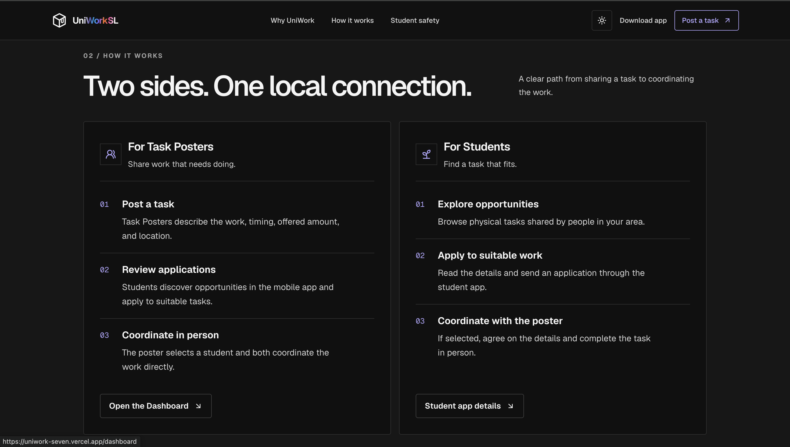

# UniWorkSL

### The First Dedicated Student Task Network in Sri Lanka.

**Small tasks. Bigger possibilities.**

Connecting Sri Lankan university students with meaningful local earning opportunities.

[**Explore UniWorkSL**](https://www.uniworksl.online) · [**Task Poster Dashboard**](https://www.uniworksl.online/dashboard) · [**Download Android App**](https://github.com/ravishanamina174/UniWorkSL/releases/download/v1.1.2/UniWorkSL-v1.1.2.apk)



---

## 01 / THE IDEA

### Good work starts close to home.

Some jobs are too small for a formal service but still need a reliable person nearby.

**UniWorkSL** connects people who need help with practical, everyday tasks to university students looking for flexible earning opportunities.

Whether it is helping at an event, moving household items, gardening, painting, or photography, UniWorkSL creates a simple way to discover and coordinate local work.

**Built around two communities. One shared opportunity.**

- **For University Students** — Discover suitable local tasks, earn money, and gain practical experience alongside studies.
- **For Task Posters** — Publish tasks, review student applications, and find help for everyday work.
- **Location-First Opportunities** — Connect people around practical, physical tasks in their communities.
- **Direct Payments** — Payments are arranged directly between Task Posters and students, without platform payment processing.

---

## 02 / TWO SIDES. ONE LOCAL CONNECTION.

UniWorkSL provides two dedicated experiences, designed around how each user actually works.

| | Task Posters | University Students |
|---|---|---|
| **Platform** | Responsive Web Dashboard | Android Mobile Application |
| **Purpose** | Find local help | Find earning opportunities |
| **Discover** | Review student applications and discover professional profiles | Browse available physical tasks |
| **Connect** | Select a suitable applicant | Apply for suitable tasks |
| **Coordinate** | Share the task-start verification code | Confirm arrival and start work |
| **Complete** | Monitor task progress | Finish work and report payment status |
| **Feedback** | Manage task activity | Submit reviews and safety reports |

### For Task Posters

**Have work that needs doing? Find the right helping hand.**

Describe your task, choose a location, set the offered payment, and publish it to the student marketplace.

[**Open Task Poster Dashboard →**](https://www.uniworksl.online/dashboard)

### For Students

**Your next opportunity could be just around the corner.**

Explore tasks that fit your skills, availability, and location. Apply from your Android phone and coordinate directly with the Task Poster.

[**Download UniWorkSL for Android →**](https://github.com/ravishanamina174/UniWorkSL/releases/download/v1.1.2/UniWorkSL-v1.1.2.apk)

---

## 03 / HOW IT WORKS

A simple process, from finding a task to completing the work.

| Step | Task Poster | Student |
|:---:|---|---|
| **01** | **Publish a task** — Add the title, description, amount, date, skills, and location. | **Explore opportunities** — Discover available tasks through the mobile marketplace. |
| **02** | **Review applications** — See interested students and select a suitable applicant. | **Apply for work** — Submit an application for a task that fits. |
| **03** | **Coordinate the task** — Agree on practical details with the selected student. | **Get selected** — View the accepted application and task information. |
| **04** | **Verify task start** — Provide the temporary four-digit verification code. | **Start the task** — Enter the code and optionally verify arrival location. |
| **05** | **Track progress** — Follow task execution and completion status. | **Complete the work** — Finish the task and report direct payment status. |
| **06** | **Close the process** — Review the final task status. | **Share feedback** — Submit reviews or safety reports where appropriate. |

**Important:** UniWorkSL connects and coordinates users. Payments take place directly between the Task Poster and student; the platform does not process, hold, or guarantee payments.

---

## 04 / BUILT FOR REAL-WORLD OPPORTUNITIES

### Practical help, in many forms.

| Category | Example Opportunities |
|---|---|
| Gardening | Grass cutting, garden care, outdoor assistance |
| Painting | Wall painting, small renovation assistance |
| Moving | Household furniture moving, packing and unloading |
| Events | Event setup, coordination and decorations |
| Photography | Events, graduation ceremonies, local photography |
| General Assistance | Everyday physical tasks and local support |

Task availability depends on listings published by Task Posters.

---

## 05 / INTELLIGENT FEATURES

UniWorkSL combines a straightforward task marketplace with carefully designed AI-assisted features.

| Feature | Description |
|---|---|
| **AI Text Enhancement** | Helps Task Posters improve the grammar and clarity of task titles and descriptions while preserving their intended meaning. |
| **Student Professional Profiles** | Students can optionally share skills, availability, preferred work areas, languages, and a professional summary. |
| **Student Lookup Agent** | Helps Task Posters discover opted-in student profiles based on task requirements, skills, location preferences, and availability. |
| **Explainable Matching** | Provides estimated match scores and relevant matching reasons rather than guaranteed predictions. |
| **Location-Based Tasks** | Supports task location selection and optional arrival-location verification. |
| **Secure Task Start** | Uses a temporary four-digit code for coordinating task initiation. |

AI-assisted suggestions support decision-making. Final task selection and coordination remain the responsibility of users.

---

## 06 / TECHNOLOGY BEHIND UNIWORKSL

A shared backend powering two dedicated user experiences.

### Technology Stack

| Layer | Technology | Purpose |
|---|---|---|
| **Web Application** | Next.js, React, TypeScript | Landing Page and Task Poster Dashboard |
| **Mobile Application** | React Native, Expo | Android application for university students |
| **Styling** | Tailwind CSS, Geist | Responsive web interface and visual design |
| **Backend** | Java 21, Spring Boot | REST API, business logic, security, and task workflows |
| **Architecture** | Modular Monolith | Organized, maintainable backend modules |
| **Database** | PostgreSQL, Neon | Cloud-hosted relational data storage |
| **Spatial Data** | PostGIS | Geographic data support |
| **Authentication** | Clerk | Authentication and user sessions |
| **AI Integration** | Google Gemini, LangChain4j | Text enhancement and student matching |
| **Web Hosting** | Vercel | Public website and dashboard |
| **API Hosting** | Render | Spring Boot backend deployment |
| **Android Builds** | Expo EAS | Standalone Android APK generation |
| **APK Distribution** | GitHub Releases | Public Android application downloads |

### Platform Architecture

```text
                      UNIWORKSL PLATFORM
                              |
                +-------------+-------------+
                |                           |
        NEXT.JS WEB APP             EXPO MOBILE APP
        Task Posters                University Students
                |                           |
                +-------------+-------------+
                              |
                      SPRING BOOT API
                       Java 21 / REST
                              |
           +------------------+------------------+
           |                  |                  |
      CLERK AUTH          NEON POSTGRES       AI SERVICES
      Authentication      + PostGIS           Gemini / LangChain4j
```

The architecture keeps shared business rules centralized while allowing both applications to offer user-specific experiences.

---

## 07 / SAFETY & RESPONSIBILITY

Real-world tasks require clear communication and responsible participation.

UniWorkSL includes task-start verification, optional foreground arrival-location checks, reviews, and private safety reporting.

These features support coordination and record useful information, but **they do not guarantee personal safety, verify every user's identity, or protect direct payments**.

Students and Task Posters should agree on the location, work, schedule, and payment before beginning a task.

---

## 08 / GET UNIWORKSL

### One platform. Two ways to participate.

| For Task Posters | For Students |
|---|---|
| Publish tasks and manage applications through the web dashboard. | Browse opportunities and manage tasks from an Android phone. |
| [**Launch Dashboard →**](https://www.uniworksl.online/dashboard) | [**Download Android APK →**](https://github.com/ravishanamina174/UniWorkSL/releases/download/v1.1.2/UniWorkSL-v1.1.2.apk) |

**Android Release v1.0.0**

[View Official Release](https://github.com/ravishanamina174/UniWorkSL/releases/tag/v1.1.2)

The application is distributed as an Android APK. Android may ask users to approve installation from their browser or file manager.

---

## 09 / PROJECT & DEVELOPMENT

UniWorkSL is developed as a **University Final Year Project** by a four-member team.

The project explores how a location-based student task marketplace can connect university students seeking flexible income opportunities with people who need practical help.

The platform is designed around real-world workflows, including user roles, task management, location data, mobile usability, AI-assisted matching, and safety considerations.

### Development Team

| Member | Role |
|---|---|
| **Raveesha** | Team Leader & Lead Developer |
| Pramila | Project Team Member |
| Imasha | Project Team Member |
| Thejan | Project Team Member |

### Project Resources

| Resource | Link |
|---|---|
| Public Website | [uniworksl.online](https://www.uniworksl.online) |
| Task Poster Dashboard | [Open Dashboard](https://www.uniworksl.online/dashboard) |
| Android Application | [Download APK](https://github.com/ravishanamina174/UniWorkSL/releases/download/v1.1.2/UniWorkSL-v1.1.2.apk) |
| Android Release History | [UniWorkSL Releases](https://github.com/ravishanamina174/UniWorkSL-Releases/releases) |

---

<div align="center">

### Small tasks. Bigger possibilities.

**UniWorkSL — Built for Sri Lankan communities and university students.**

[Website](https://www.uniworksl.online) · [Dashboard](https://www.uniworksl.online/dashboard) · [Android App](https://github.com/ravishanamina174/UniWorkSL/releases/download/v1.1.2/UniWorkSL-v1.1.2.apk)

© 2026 UniWorkSL. Made in Sri Lanka.

</div>
